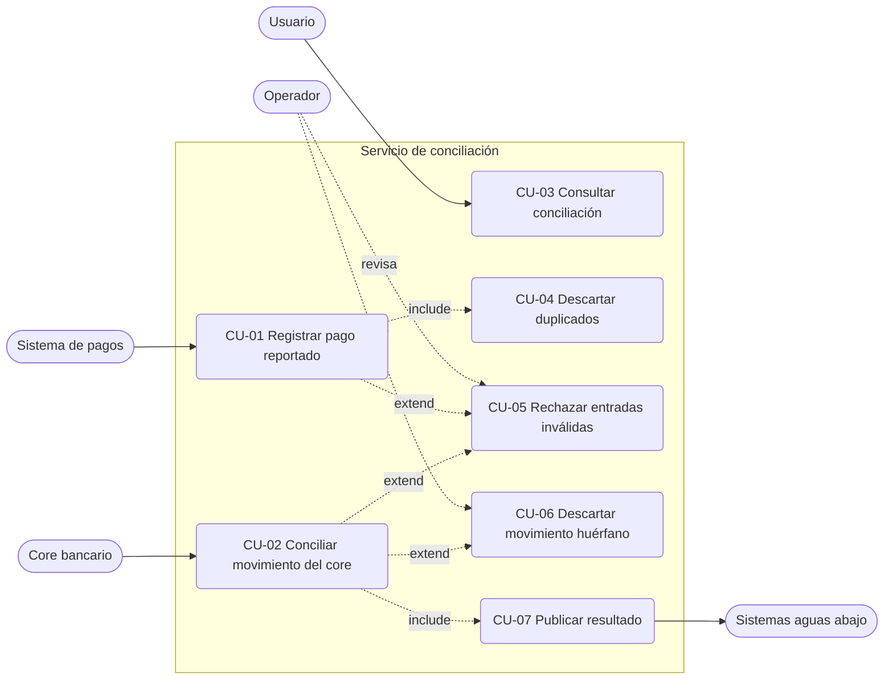

# Especificación de casos de uso

Funcionalidades del servicio de conciliación de pagos, tal como están implementadas. Cada caso
referencia los requisitos del spec (`specs/001-payment-reconciliation/spec.md`) y los diagramas de
secuencia de [`sequence.md`](sequence.md). Términos en [`glossary.md`](glossary.md).

## 1. Actores

| Actor | Tipo | Descripción |
|-------|------|-------------|
| Sistema de pagos | Sistema externo (primario) | Publica `PaymentExecuted` en el topic de pagos. |
| Core bancario | Sistema externo (primario) | Publica `CoreTransactionReported` en el topic de movimientos. |
| Usuario / consumidor de la API | Humano o sistema (primario) | Consulta una conciliación por HTTP. |
| Sistemas aguas abajo | Sistema externo (secundario) | Consumen `ReconciliationMatched` y `DiscrepancyDetected`. |
| Operador | Humano (secundario) | Revisa las DLQ y los logs `WARN`; reprocesa a mano. |

## 2. Mapa de casos de uso

| ID | Caso de uso | Disparador | Prioridad |
|----|-------------|------------|-----------|
| CU-01 | Registrar pago reportado | Mensaje en el topic de pagos | P1 |
| CU-02 | Conciliar movimiento del core | Mensaje en el topic de movimientos | P1 |
| CU-03 | Consultar conciliación | `GET /v1/reconciliations/{operationReference}` | P3 |
| CU-04 | Descartar duplicados | Pago con referencia ya registrada | P2 |
| CU-05 | Rechazar entradas inválidas | Mensaje que incumple FR-022 | P2 |
| CU-06 | Descartar movimiento huérfano | Movimiento sin conciliación | P2 |
| CU-07 | Publicar resultado | Conciliación recién resuelta | P1 |

## 3. Reglas de negocio compartidas

| ID | Regla | Requisito |
|----|-------|-----------|
| RN-01 | La clave de negocio es `operationReference` (≤ 64 caracteres). Hay a lo sumo una conciliación por referencia. | FR-019 |
| RN-02 | Solo se admite moneda `PEN`. | FR-022 |
| RN-03 | Todo monto se normaliza a 2 decimales con redondeo `HALF_UP` **antes** de validarlo y compararlo. `120.0` y `120.00` son el mismo monto. | FR-023 |
| RN-04 | Un monto válido es mayor que cero tras la normalización. | FR-022 |
| RN-05 | Diferencia = monto del pago − monto del core. | FR-005 |
| RN-06 | Tolerancia fija PEN 1.00, inclusiva: `0 ≤ diferencia ≤ 1.00` es `MATCHED`. Una diferencia mayor o negativa (el core cobró de más) es `MISMATCHED`. | FR-006, FR-007, FR-008 |
| RN-07 | Estados: `PENDING`, `MATCHED`, `MISMATCHED`. Solo `PENDING → MATCHED` y `PENDING → MISMATCHED`; los estados resueltos son finales. | FR-010, FR-011, FR-012 |
| RN-08 | La diferencia exacta se guarda en toda conciliación resuelta. | FR-009 |
| RN-09 | El resultado se publica solo después de confirmar la transacción. | FR-015 |
| RN-10 | La idempotencia se decide por `operationReference`, nunca por el id del evento. | FR-019 |

## 4. Especificación detallada

### CU-01 Registrar pago reportado

| Campo | Contenido |
|-------|-----------|
| Actor primario | Sistema de pagos |
| Objetivo | Dejar constancia de un pago a la espera de su movimiento en el core. |
| Disparador | Evento `PaymentExecuted` (id de evento, referencia, monto, moneda, cuenta). |
| Precondiciones | El mensaje llegó al topic de pagos y se deserializó con el esquema Avro. |
| Postcondiciones (éxito) | Existe una conciliación `PENDING` para la referencia. No se publica nada (FR-016). El mensaje se confirma (ack). |
| Reglas | RN-01, RN-02, RN-03, RN-04, RN-10 |
| Requisitos | FR-001, FR-002, FR-016, FR-019 |
| Diagrama | `sequence.md` §1 |

**Flujo principal**

1. El consumidor recibe `PaymentExecuted` y lo convierte en comando (monto normalizado, referencia
   y cuenta validadas).
2. El servicio verifica que la moneda sea PEN.
3. Registra la referencia en Redis (`SET NX EX`, TTL 24 h); la clave era nueva.
4. Crea la conciliación en `PENDING`.
5. La guarda en una transacción (`INSERT`) y confirma.
6. El consumidor hace ack.

**Flujos alternativos**

- 3a. La clave ya existía en Redis → CU-04.
- 3b. Redis no responde → se omite el filtro con un `WARN` y se continúa; la garantía la da el índice `UNIQUE`.
- 5a. El índice `UNIQUE` rechaza el `INSERT` → CU-04.
- 1a / 2a. Datos inválidos → CU-05.

**Excepciones**

- La base de datos no está disponible: el método lanza, el mensaje se rechaza (nack) y va a la DLQ de pagos.

### CU-02 Conciliar movimiento del core

| Campo | Contenido |
|-------|-----------|
| Actor primario | Core bancario |
| Objetivo | Resolver la conciliación comparando el monto del pago con el del core. |
| Disparador | Evento `CoreTransactionReported` (id de evento, referencia, monto, moneda). |
| Precondiciones | Existe una conciliación `PENDING` con esa referencia. |
| Postcondiciones (éxito) | La conciliación queda `MATCHED` o `MISMATCHED` con la diferencia, el movimiento del core y `resolvedAt`; se publica el resultado (CU-07). |
| Reglas | RN-02 a RN-09 |
| Requisitos | FR-003 a FR-012, FR-020 |
| Diagrama | `sequence.md` §2 |

**Flujo principal**

1. El consumidor recibe `CoreTransactionReported` y lo convierte en comando.
2. El servicio verifica que la moneda sea PEN.
3. Dentro de una transacción busca la conciliación por referencia.
4. Comprueba que siga `PENDING` (`isResolved()` es falso).
5. Calcula `diferencia = monto del pago − monto del core`.
6. Si `0 ≤ diferencia ≤ 1.00` la marca `MATCHED`; en otro caso, `MISMATCHED`.
7. Guarda estado, diferencia, datos del core y `resolvedAt`, y confirma.
8. Ejecuta CU-07.
9. El consumidor hace ack.

**Flujos alternativos**

- 3a. No existe conciliación → CU-06.
- 4a. Ya estaba resuelta (movimiento repetido) → se descarta con `WARN`, sin transición ni publicación, y se hace ack.
- 1a / 2a. Datos inválidos → CU-05.

**Ejemplos de clasificación**

| Pago | Core | Diferencia | Resultado |
|------|------|-----------:|-----------|
| 100.00 | 100.00 | 0.00 | MATCHED |
| 100.00 | 99.00 | 1.00 | MATCHED (límite inclusivo) |
| 100.00 | 98.99 | 1.01 | MISMATCHED |
| 100.00 | 100.50 | −0.50 | MISMATCHED (core cobró de más) |

### CU-03 Consultar conciliación

| Campo | Contenido |
|-------|-----------|
| Actor primario | Usuario |
| Objetivo | Conocer el estado y la diferencia de una operación. |
| Disparador | `GET /v1/reconciliations/{operationReference}` |
| Precondiciones | Ninguna. |
| Postcondiciones | Solo lectura; no modifica nada. |
| Requisitos | FR-017, FR-018 |
| Diagrama | `sequence.md` §3 |

**Flujo principal**

1. El usuario envía la petición con la referencia.
2. El servicio busca la conciliación.
3. Responde `200 application/json` con referencia, estado, montos y, si está resuelta, la diferencia.

**Flujo alternativo**

- 2a. No existe → `404 application/problem+json`.

### CU-04 Descartar duplicados

| Campo | Contenido |
|-------|-----------|
| Actor primario | Sistema de pagos (reenvío) |
| Objetivo | Que reenviar un pago produzca un único efecto. |
| Disparador | `PaymentExecuted` con una referencia ya registrada (mismo o distinto id de evento). |
| Postcondiciones | La conciliación existente no cambia; se registra un `INFO`; ack; nada va a la DLQ. |
| Reglas | RN-01, RN-10 |
| Requisitos | FR-019, SC-003, SC-007 |

**Flujo principal**

1. Redis indica que la clave ya existía, o la base rechaza el `INSERT` por el índice `UNIQUE`.
2. El servicio descarta el pago, lo registra en el log y termina sin error.

Un duplicado se trata como éxito, no como fallo. El filtro Redis solo acelera; la garantía final es
el índice `UNIQUE`.

### CU-05 Rechazar entradas inválidas

| Campo | Contenido |
|-------|-----------|
| Actor primario | Sistema de pagos o Core bancario |
| Objetivo | Impedir que datos incorrectos creen o modifiquen conciliaciones. |
| Disparador | Mensaje que incumple alguna condición de FR-022. |
| Postcondiciones | No se crea ni modifica ninguna conciliación; el mensaje se rechaza (nack) y va a la DLQ de su propio canal. |
| Requisitos | FR-022, FR-023, SC-005 |

**Condiciones de invalidez**

| Condición | Pago | Movimiento |
|-----------|:----:|:----------:|
| Monto cero o negativo (tras redondear) | ✔ | ✔ |
| Moneda distinta de PEN | ✔ | ✔ |
| Referencia ausente o en blanco | ✔ | ✔ |
| Cuenta ausente o en blanco | ✔ | — |

**Flujo principal**

1. El mapper o el servicio detecta la condición y lanza una excepción.
2. El mensaje se rechaza (nack).
3. La estrategia `dead-letter-queue` lo envía al topic DLQ del canal por el que llegó.
4. El operador lo revisa y decide su reproceso (manual, fuera del alcance del servicio).

Un monto con más de 2 decimales **no** es inválido: se redondea (`10.005` → `10.01`). `0.004` queda en
`0.00` y se rechaza.

### CU-06 Descartar movimiento huérfano

| Campo | Contenido |
|-------|-----------|
| Actor primario | Core bancario |
| Disparador | `CoreTransactionReported` sin conciliación con esa referencia. |
| Postcondiciones | Nada se crea ni se publica; `WARN` en el log; ack; no va a la DLQ. |
| Requisitos | FR-021, SC-007 |

**Limitación conocida**: si el movimiento llega **antes** que su pago, se descarta aquí y el pago,
al llegar después, queda `PENDING` para siempre. El servicio no reintenta ni reordena entre canales.

### CU-07 Publicar resultado

| Campo | Contenido |
|-------|-----------|
| Actor primario | Servicio (incluido por CU-02) |
| Actores secundarios | Sistemas aguas abajo |
| Disparador | Transacción de CU-02 confirmada. |
| Postcondiciones | `MATCHED` → `ReconciliationMatched` en el topic de resultados; `MISMATCHED` → `DiscrepancyDetected` en el topic de discrepancias. La clave del mensaje es la referencia. |
| Requisitos | FR-013, FR-014, FR-015, FR-016, SC-004 |
| Diagrama | `sequence.md` §2 |

**Reglas**

- Se publica solo después del commit (RN-09); nunca se publica una conciliación en `PENDING`.
- Cada resultado se publica una sola vez, en un único topic.
- Si la publicación falla, el error se registra y no se propaga: la conciliación queda resuelta sin
  evento de salida (no hay outbox ni reintento).

## 5. Trazabilidad

| Requisito | Casos de uso |
|-----------|--------------|
| FR-001, FR-002 | CU-01 |
| FR-003 a FR-009 | CU-02 |
| FR-010 a FR-012, FR-020 | CU-02 |
| FR-013 a FR-016 | CU-07 |
| FR-017, FR-018 | CU-03 |
| FR-019 | CU-01, CU-04 |
| FR-021 | CU-06 |
| FR-022, FR-023 | CU-05, CU-01, CU-02 |

## 6. Fuera de alcance

Autenticación, reintentos, outbox, métricas, listados o búsquedas en la API, edición manual de
conciliaciones, reproceso automático de la DLQ y orden garantizado entre canales.
