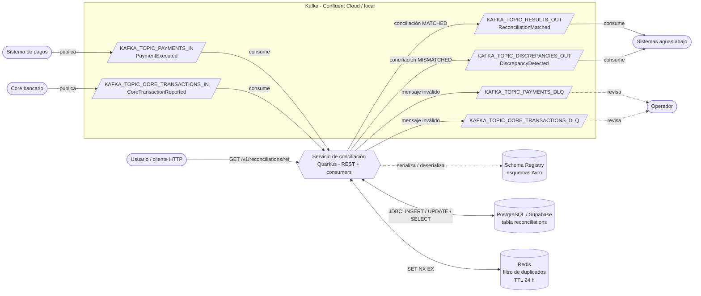

# Diagrama de contexto

Qué rodea al servicio: sistemas externos, topics de Kafka y almacenes de datos. Los nombres de
topic son las variables de entorno que los configuran (el valor real lo define el equipo).

## Elementos

| Elemento | Tipo | Dirección | Uso |
|----------|------|-----------|-----|
| `KAFKA_TOPIC_PAYMENTS_IN` | Topic | Entrada | Pagos reportados |
| `KAFKA_TOPIC_CORE_TRANSACTIONS_IN` | Topic | Entrada | Movimientos del core |
| `KAFKA_TOPIC_RESULTS_OUT` | Topic | Salida | Conciliaciones conformes |
| `KAFKA_TOPIC_DISCREPANCIES_OUT` | Topic | Salida | Conciliaciones discrepantes |
| `KAFKA_TOPIC_PAYMENTS_DLQ` | Topic | Salida (error) | Pagos inválidos |
| `KAFKA_TOPIC_CORE_TRANSACTIONS_DLQ` | Topic | Salida (error) | Movimientos inválidos |
| Schema Registry | Servicio | Lectura | Esquemas Avro; el servicio no los registra |
| PostgreSQL (Supabase) | Base de datos | Lectura/escritura | Única fuente de verdad; índice `UNIQUE` por referencia |
| Redis | Caché | Lectura/escritura | Solo acelera la idempotencia; si cae, se omite |
| API REST | HTTP | Entrada | `GET /v1/reconciliations/{operationReference}` |

Los topics salientes llevan la referencia de operación como key. Los topics, los esquemas y
`db/schema.sql` los crea una persona, no el servicio.
