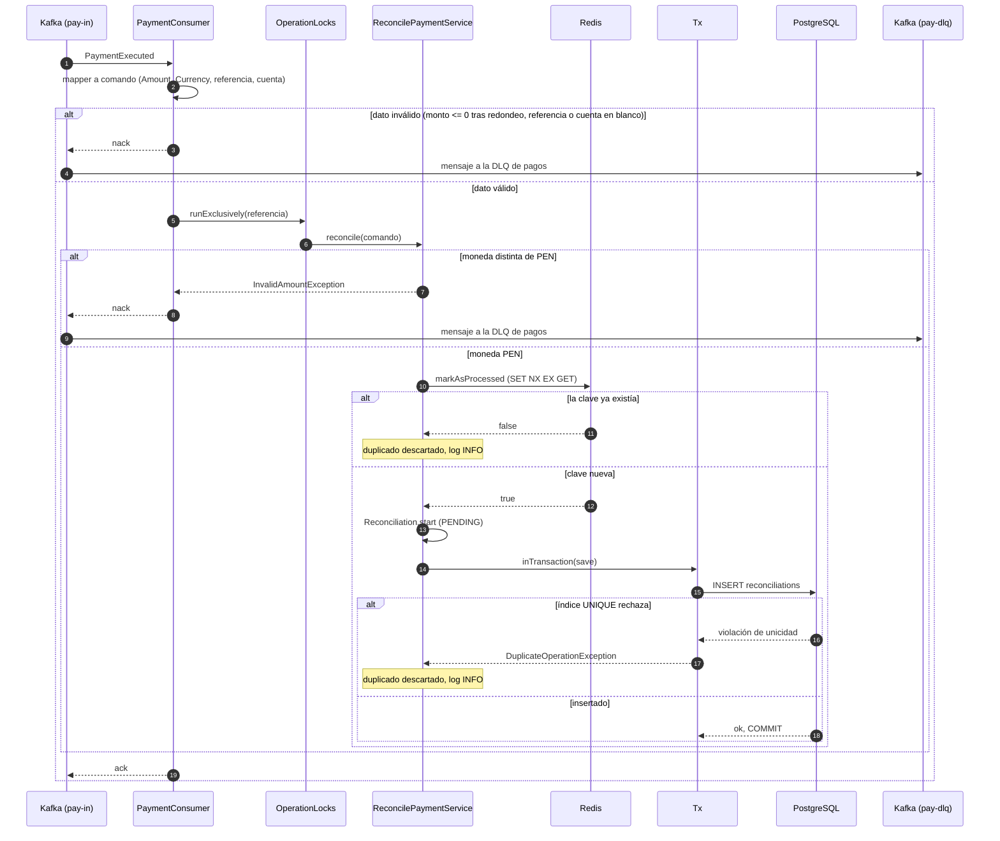
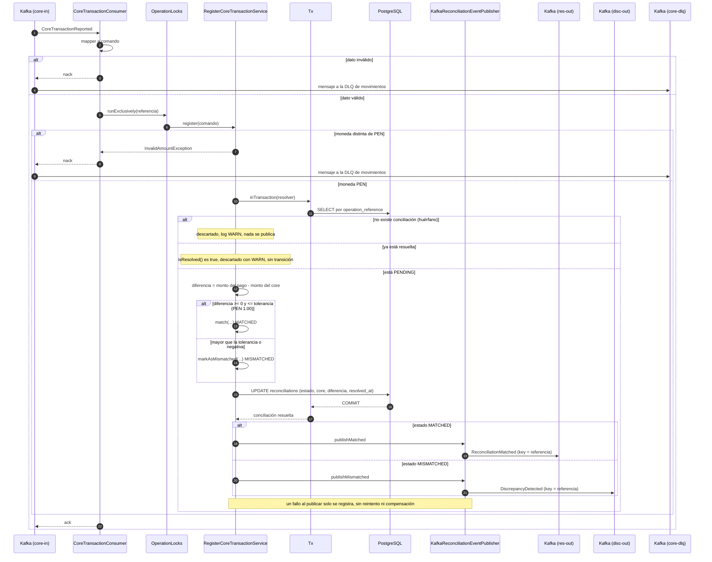
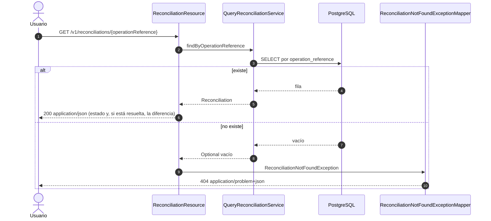
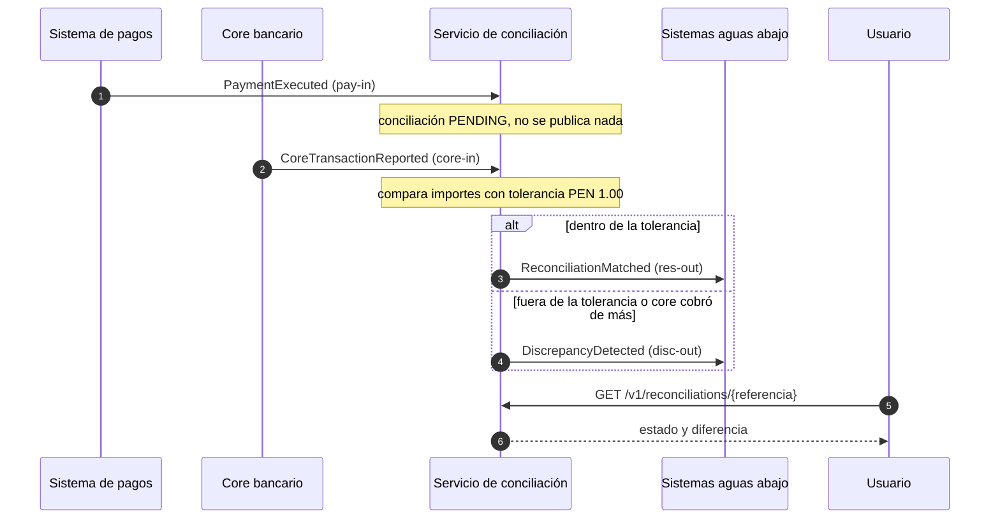

# Diagramas de secuencia

Flujos del servicio tal como están implementados. Los diagramas usan [Mermaid](https://mermaid.js.org/):
se ven directamente en GitHub y en el preview de Markdown de la mayoría de IDEs.

Participantes comunes:

- **Consumer**: `PaymentConsumer` o `CoreTransactionConsumer` (hilos virtuales, concurrencia 1 por
  canal, por lo que procesan los mensajes de su canal de uno en uno y en orden de llegada).
- **Locks**: `OperationLocks`, exclusión mutua por referencia entre los dos canales.
- **Tx**: `TransactionalExecutor` (puerto), implementado con `QuarkusTransaction`. Confirma la
  transacción antes de devolver el control.

## 1. Pago reportado (`PaymentExecuted`)

Crea la conciliación en `PENDING`. No publica nada.

Si Redis no responde, el filtro se omite con un WARN y la garantía la da el índice `UNIQUE`.

## 2. Movimiento del core (`CoreTransactionReported`)

Resuelve la conciliación como `MATCHED` o `MISMATCHED` y publica el resultado **después** del commit.

El `ack` ocurre siempre que el método vuelve sin excepción, incluidos los descartes. Solo los mensajes
inválidos terminan en la DLQ.

## 3. Consulta por referencia

## 4. Vista de conjunto

## Limitaciones que el diagrama no muestra

1. **Orden entre canales**: un movimiento que llega antes que su pago se descarta (rama "huérfano") y
   el pago queda `PENDING` para siempre.
2. **Sin outbox**: si el servicio cae entre el `COMMIT` y la publicación, la conciliación queda
   resuelta sin evento de salida.
